# SYSTEM_DEPENDENCY_GRAPH — sne.space (2026-11-01)

Grounded in code: `serve/server.py`, `ingest/pull_recent.py`, `ingest/publication.py`,
`ingest/catalog_publish.py`, `ingest/reconcile_catalog_store.py`, `serve/catalog_store.py`,
`serve/catalog_engine.py`, `docker-entrypoint.sh`, `docker-compose.yml`.

Single-process topology: one container runs the HTTP server **and** all background
loops as daemon threads. No separate scheduler/worker services.

## Threads / loops started in `server.main()`

| Thread | Cadence | Role |
| --- | --- | --- |
| `catalog-store-warm` | once at boot | build/attach CatalogStore (`_warm_catalog_store`) |
| `tns-recent` | every `SNE_TNS_POLL_SECONDS` (default 900 s) | `_recent_tns_loop` → `pull_recent()` |
| `enrich-worker-{0,1}` | continuous | drain `_ENRICH_QUEUE` |
| `init_cone_index` | once at boot | spatial index |

`sync_cron.py` exists but is **not wired into the container CMD** (no crontab, no
entrypoint call); it is a manual/optional entry point. The live automated ingest
path is `_recent_tns_loop`.

## Stage graph (one event)

```dot
digraph sne {
  rankdir=LR;
  TNS [shape=box]; ALeRCE [shape=box]; WISeREP [shape=box]; AstroCats [shape=box];
  PullRecent [label="pull_recent()\n(_recent_tns_loop, 15 min)"];
  BuildEvent [label="build_event_dict()\nenrich_alerce/wiserep/tns_spectra"];
  EventJSON [label="event JSON\natomic_write_json + event_file_lock"];
  MarkIngest [label="mark_ingested()\nstate=pending (fsync)"];
  EnrichQ [label="_ENRICH_QUEUE\n(in-memory deque, max 256)"];
  EnrichEvent [label="enrich_event()\nrequest-driven"];
  PubPaths [label="publish_event_paths()\npending→publishing→published"];
  Overlay [label="published-updates.min.json\n(runtime volume)"];
  Store [label="CatalogStore\ncatalog.db (data volume)"];
  RecentCat [label="recent-catalog.min.json"];
  Engine [label="CatalogEngine\nrevision-aware merge"];
  API [label="/api/transients"];
  Home [label="homepage SSR\nrecent-events.json"];
  Page [label="event page\n+ page cache"];
  DL [label="downloads\n/sne/NAME.json"];

  TNS -> PullRecent; PullRecent -> BuildEvent;
  ALeRCE -> BuildEvent; WISeREP -> BuildEvent;
  BuildEvent -> EventJSON; EventJSON -> MarkIngest;
  PullRecent -> RecentCat; PullRecent -> PubPaths;
  Page -> EnrichQ; EnrichQ -> EnrichEvent; EnrichEvent -> EventJSON;
  MarkIngest -> PubPaths; PubPaths -> Overlay; PubPaths -> Store;
  Store -> Engine; Overlay -> Engine; RecentCat -> Engine;
  Engine -> API; RecentCat -> Home; EventJSON -> Page; EventJSON -> DL;
}
```

## Boundary contracts and failure behavior

| # | Boundary | Producer → Consumer | State | Failure / retry | Silent-skip conditions |
| --- | --- | --- | --- | --- | --- |
| 1 | TNS search → rows | TNS → `pull_recent` | none | whole-pull exception logged; loop retries next tick | TNS 429 rate-limit; only page-0 within window (older window events dropped as window slides) |
| 2 | rows → event build | `pull_recent` → `build_event_dict` | none | per-event try/except `continue` | ALeRCE/WISeREP exception → event skipped this cycle; `_needs_enrich` true → retried next cycle **only while still in window** |
| 3 | build → event JSON | `build_event_dict` → `atomic_write_json` (under `event_file_lock`) | durable file | exception → skip; not retried outside window | same as #2 |
| 4 | JSON → publication pending | `mark_ingested` | `publication_state.json` (fsync) | failure **now logged** (was silent `except: pass`) | if `mark_ingested` itself fails, event never enters pending set |
| 5 | pending → published | `publish_event_paths` | state machine | `recover_pending()` at next `pull_recent` start; `pending_names()` replays pending/failed/publishing | **only replays names already in state file** — never-registered events invisible |
| 6 | publish → overlay + store | `publish_event_paths` → overlay, `CatalogStore.upsert_catalog_items` | overlay JSON + SQLite | exception → `failed` state; retried via `recover_pending` | store db missing → overlay-only, `upserted=0`, **state still marked published** (gap) |
| 7 | request → enrichment | HTTP handler → `_ENRICH_QUEUE.enqueue` | in-memory deque | bounded: overflow **dropped**; max 3 attempts then `failed` | queue full → drop; cooldown → drop; restart → pending set lost |
| 8 | store/overlay/recent → API | `CatalogEngine` merge | derived | n/a | unrevisioned recent stub vs store (P0A fixed ordering) |
| 9 | recent-events → homepage | SSR reads `recent-events.json` | runtime volume | n/a | stale until next pull; separate stat counter source |
| 10 | JSON → page/download | `_find_event_json`, page cache | file + cache | missing JSON → catalog stub page | case-sensitive name resolution |

## Paths that create an event without completing downstream ops

1. `build_event_dict` succeeds, JSON written, `mark_ingested` raises (pre-fix silent) →
   file exists, no pending entry, no publish. **Mitigated:** failure now logged; but
   if the process dies between write and mark, still unregistered.
2. `publish_event_paths` with missing catalog.db → overlay written, `upserted=0`,
   yet `mark_published` runs → state says published, store lacks row. **Gap.**
3. Enrichment queue drops on overflow/cooldown/restart → event never enriched.
4. Events aged out of TNS window with `publish_status` never set → only the new
   `reconcile_catalog_store` finds them.

## Races / concurrency

- `event_file_lock` serializes per-file writes; `fcntl` serializes `publish_revision`.
- `_ENRICH_QUEUE` single-flight per name; dedupe via pending scan + inflight set.
- `CatalogStore.upsert_catalog_items` holds `_build_lock`; readers use WAL.
- `provider_quota.recent_ingest_priority()` fcntl-coordinates ingest vs backfill
  **only when processes share the filesystem** (sidecar note in compose).
